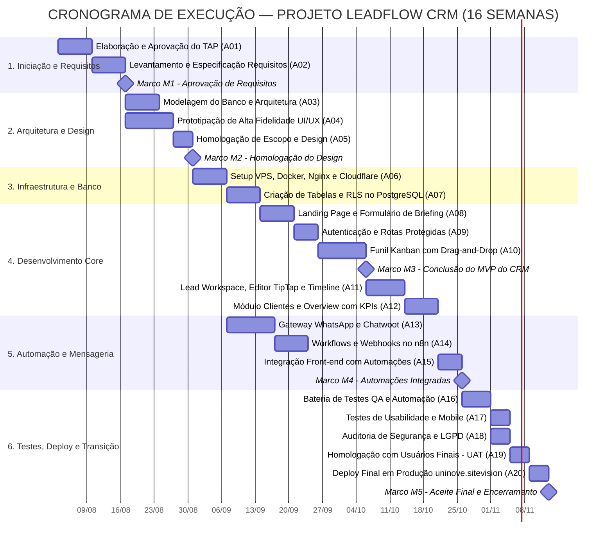
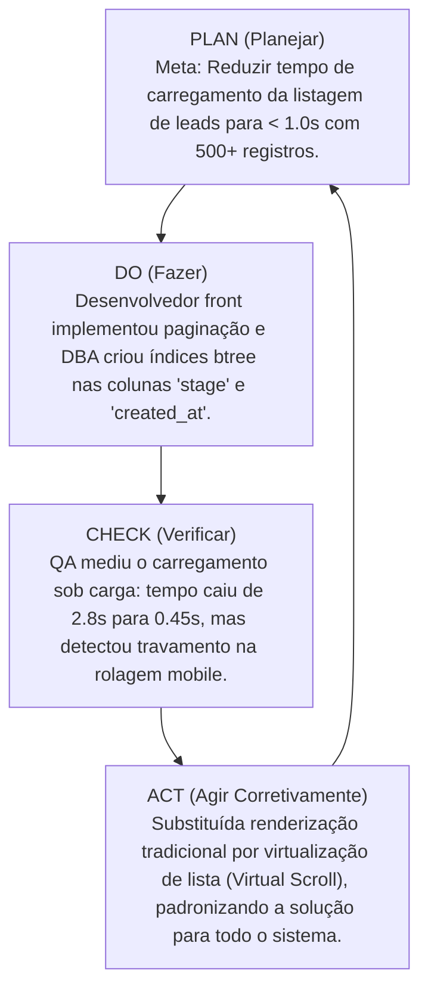

# UNIVERSIDADE NOVE DE JULHO — UNINOVE
## CURSO SUPERIOR DE TECNOLOGIA EM ANÁLISE E DESENVOLVIMENTO DE SISTEMAS
### DISCIPLINA: GESTÃO DE PROJETOS | SEMESTRE: 2026-2
**Orientadora:** Prof.ª Rosana Cordovil da Silva

---

# LEADFLOW — CRM COM AUTOMAÇÃO MULTICANAL DE LEADS
### DOCUMENTO OFICIAL DE ENTREGA FINAL DO PROJETO

**URL em Produção:** [https://uninove.sitevision.com.br](https://uninove.sitevision.com.br)  
**Repositório e Servidor Local:** `/opt/uninove/crm`  
**Data da Entrega:** Outubro de 2026  
**Local:** São Paulo — SP  

---

### EQUIPE DE PROJETO E ATRIBUIÇÕES

| Integrante | Registro Acadêmico (RA) | Função Principal |
| :--- | :--- | :--- |
| **Jaqueline Vitória Maraci** | **925203619** | **Gestora de Projeto (Project Manager / Scrum Master)** |
| **Fledson Oliveira Silva Bispo** | **926201748** | **Desenvolvedor Back-end & DevOps** |
| **Gabriel Alves Gouveia** | **925208265** | **Desenvolvedor Front-end & UI/UX** |
| **Guilherme de Lima Silva** | **925201716** | **Analista de Testes e Garantia da Qualidade (QA)** |
| **Weverton Cordeiro** | **925203088** | **Analista de Banco de Dados & DBA** |

---

## SUMÁRIO GERAL

1. [Capa e Identificação da Equipe](#1-capa-e-identificação-da-equipe)
2. [Descrição do Projeto](#2-descrição-do-projeto)
3. [Identificação e Análise dos Stakeholders](#3-identificação-e-análise-dos-stakeholders)
4. [Termo de Abertura do Projeto (TAP)](#4-termo-de-abertura-do-projeto-tap)
5. [Levantamento de Requisitos](#5-levantamento-de-requisitos)
6. [Declaração do Escopo](#6-declaração-do-escopo)
7. [Estrutura Analítica do Projeto (EAP)](#7-estrutura-analítica-do-projeto-eap)
8. [Dicionário da EAP](#8-dicionário-da-eap)
9. [Lista e Sequenciamento das Atividades](#9-lista-e-sequenciamento-das-atividades)
10. [Estimativas de Duração com PERT](#10-estimativas-de-duração-com-pert)
11. [Cronograma e Gráfico de Gantt](#11-cronograma-e-gráfico-de-gantt)
12. [Planejamento dos Recursos](#12-planejamento-dos-recursos)
13. [Matriz de Responsabilidades (RACI)](#13-matriz-de-responsabilidades-raci)
14. [Estimativa de Custos e Orçamento](#14-estimativa-de-custos-e-orçamento)
15. [Plano de Comunicação](#15-plano-de-comunicação)
16. [Registro e Matriz de Riscos](#16-registro-e-matriz-de-riscos)
17. [Plano de Qualidade](#17-plano-de-qualidade)
18. [Planejamento da Execução](#18-planejamento-da-execução)
19. [Aplicação do Ciclo PDCA](#19-aplicação-do-ciclo-pdca)
20. [Relatório de Monitoramento e Controle](#20-relatório-de-monitoramento-e-controle)
21. [Controle de Qualidade](#21-controle-de-qualidade)
22. [Gestão de Mudanças](#22-gestão-de-mudanças)
23. [Simulação de Problema no Projeto](#23-simulação-de-problema-no-projeto)
24. [Encerramento do Projeto](#24-encerramento-do-projeto)
25. [Lições Aprendidas](#25-lições-aprendidas)
26. [Conclusão](#26-conclusão)
27. [Referências Bibliográficas](#27-referências-bibliográficas)

---

## 1. CAPA E IDENTIFICAÇÃO DA EQUIPE

- **Instituição de Ensino:** Universidade Nove de Julho — UNINOVE
- **Campus:** Memorial / Vila Maria — São Paulo / SP
- **Curso:** Curso Superior de Tecnologia em Análise e Desenvolvimento de Sistemas (ADS)
- **Área Temática:** Engenharia de Software e Gestão Estratégica de Tecnologia da Informação
- **Disciplina:** Gestão de Projetos
- **Professora Orientadora:** Prof.ª Rosana Cordovil da Silva
- **Nome do Projeto:** **LeadFlow — CRM com Automação Multicanal de Leads**
- **Ecossistema Implantado:** Aplicação Web SPA responsiva hospedada sob o domínio institucional de demonstração `https://uninove.sitevision.com.br`, orquestrada por Nginx reverso na VPS Linux, tunelamento seguro via Cloudflare Zero Trust Tunnel, persistência gerenciada em PostgreSQL/Supabase com Row Level Security (RLS), mensageria via Evolution API (WhatsApp Gateway), atendimento em tempo real via Chatwoot e automação de fluxos pelo n8n.
- **Equipe Executora:**
  1. **Jaqueline Vitória Maraci (RA: 925203619)**: Gestora do Projeto (PMO/Scrum Master). Condução dos ritos ágeis, alinhamento de escopo, cronograma, orçamentos, riscos e homologação formal de entregas.
  2. **Fledson Oliveira Silva Bispo (RA: 926201748)**: Desenvolvedor Back-end & Engenheiro DevOps. Configuração do ambiente VPS, containers Docker, Nginx, túneis Cloudflare, rotas de API e integrações com n8n e Evolution API.
  3. **Gabriel Alves Gouveia (RA: 925208265)**: Desenvolvedor Front-end & UI/UX Designer. Desenvolvimento da interface SPA em React 18, TypeScript, Tailwind CSS, Radix UI, DnD Kit (Kanban) e componentes visuais do dashboard.
  4. **Guilherme de Lima Silva (RA: 925201716)**: Analista de Garantia da Qualidade (QA/Tester). Criação dos planos de testes unitários, testes de integração, testes de estresse, validação de regras de negócio e checagem de conformidade com a LGPD.
  5. **Weverton Cordeiro (RA: 925203088)**: Analista de Banco de Dados (DBA/Data Architect). Modelagem relacional, criação de tabelas, índices de busca, políticas de segurança Row Level Security (RLS) no Supabase/Postgres e rotinas de backup.

---

## 2. DESCRIÇÃO DO PROJETO

### 2.1 Qual problema será resolvido?
O projeto **LeadFlow** resolve o problema crônico da **perda massiva de oportunidades comerciais e desorganização no atendimento de leads em pequenas e médias empresas (PMEs) prestadoras de serviços**. 
No cenário corporativo real, a grande maioria das PMEs investe recursos financeiros em anúncios digitais (Meta Ads, Google Ads) e canais sociais, mas concentra o atendimento em contas pessoais e descentralizadas de WhatsApp ou em planilhas eletrônicas desconexas (Excel/Google Sheets). Essa rotina fragmentada gera:
- **Demora excessiva no primeiro contato:** leads esfriam após aguardar horas pelo retorno;
- **Duplicidade de abordagem ou abandono:** atendentes abordam o mesmo cliente simultaneamente ou assumem que outro colega já o atendeu;
- **Perda irrecuperável do histórico:** quando um colaborador se ausenta ou é desligado, todo o relacionamento mantido em seu dispositivo particular é extraviado;
- **Cegueira analítica:** gestores não sabem qual campanha de marketing gera receita real, qual é o tempo médio de resposta da equipe e onde os clientes travam no funil de vendas.

### 2.2 Qual necessidade originou o projeto?
A necessidade originou-se da constatação de que as soluções de CRM tradicionais do mercado corporativo (como Salesforce, HubSpot ou RD Station) impõem barreiras severas para PMEs: custos de licenciamento em moeda estrangeira, excessiva complexidade de configuração, curva de aprendizado íngreme e falta de integração nativa e acessível com o ecossistema brasileiro de mensageria instantânea (WhatsApp). Identificou-se a demanda urgente por uma plataforma integrada, ágil, visual, que unifique captação via web, triagem automática, funil kanban e mensageria em um painel único.

### 2.3 Quem será beneficiado?
- **Pequenas e Médias Empresas (PMEs):** Clínicas médicas/odontológicas, escritórios de advocacia, consultorias contábeis, agências digitais, imobiliárias, escolas e prestadores de serviços técnicos;
- **Gestores Comerciais:** Ganham visibilidade em tempo real sobre métricas de conversão, produtividade da equipe, origens mais lucrativas e funil de vendas;
- **Vendedores e Atendentes:** Passam a operar um ambiente de trabalho unificado (*Lead Workspace*), com histórico de anotações ricas, lembretes de follow-up, classificação de temperatura e cards kanban de movimentação simples;
- **Consumidores Finais (Leads):** Beneficiados por um atendimento célere, contextualizado, personalizado e com respeito estrito à sua privacidade de dados (LGPD).

### 2.4 Qual será o resultado final esperado?
O resultado final é o ecossistema web **LeadFlow**, disponível e operacional em [https://uninove.sitevision.com.br](https://uninove.sitevision.com.br), composto por:
1. Uma **Landing Page de Alta Conversão** com formulário público de Briefing dinâmico, que calcula automaticamente a pontuação (*score*) do lead baseado em orçamento e urgência;
2. Um **Painel Administrativo com Pipeline Kanban Interativo** (Drag and Drop com 7 fases de negócio: *Novo Lead*, *Qualificado*, *Em Atendimento*, *Proposta Enviada*, *Negociação*, *Fechado*, *Perdido*);
3. Um **Lead Workspace Individual** contendo linha do tempo (*timeline*), editor de notas ricas (TipTap), campos de edição rápida em tempo real e tags customizáveis;
4. **Módulos de Gestão de Clientes e Faturamento**, permitindo transicionar oportunidades ganhas diretamente para a carteira de clientes ativos;
5. Um **Dashboard Analítico de Inteligência Comercial (Overview)** com gráficos e KPIs (Taxa de Conversão, Origens de Tráfego, Volume por Etapa, Pipeline Financeiro);
6. **Automações de Backend com Mensageria e Webhooks**, integrando containers Docker de WhatsApp Gateway (Evolution API), Atendimento Omnichannel (Chatwoot) e rotinas lógicas no n8n.

### 2.5 Por que vale a pena realizar esse projeto?
- **Retorno Sobre o Investimento (ROI) Comprovado:** A redução do tempo de resposta de 2 horas para menos de 5 minutos eleva a taxa de conversão comercial entre 15% e 35%;
- **Eficiência Operacional:** Elimina mais de 10 horas semanais de preenchimento manual de planilhas e digitação redundante de contatos;
- **Segurança Jurídica e Conformidade com a LGPD:** Todos os consentimentos, históricos e dados pessoais são centralizados em banco relacional seguro com criptografia em trânsito e repouso, substituindo a vulnerabilidade de celulares particulares;
- **Viabilidade Tecnológica:** Desenvolvido sobre tecnologias modernas de código aberto e nuvem elástica, mantendo o custo de manutenção acessível para qualquer empresa em crescimento.

---

## 3. IDENTIFICAÇÃO E ANÁLISE DOS STAKEHOLDERS

### 3.1 Identificação e Mapeamento
Os stakeholders foram catalogados de acordo com sua capacidade de influenciar as decisões e os resultados do projeto.

| Stakeholder | Papel no Projeto | Grau de Interesse | Nível de Poder/Influência | Necessidades e Expectativas Principais |
| :--- | :--- | :--- | :--- | :--- |
| **Cliente / Direção da PME** | Sponsor e Contratante | Alto | Alto | Entrega no prazo acordado, ROI positivo, estabilidade do sistema e aumento no fechamento de vendas. |
| **Gestores Comerciais** | Usuários-chave de Gestão | Alto | Alto | Visibilidade do funil de vendas, métricas de desempenho dos atendentes e relatórios automáticos. |
| **Vendedores e Atendentes** | Usuários Finais Operacionais | Alto | Médio | Sistema intuitivo, rápido, que simplifique o follow-up diário e elimine o trabalho burocrático de planilhas. |
| **Consumidores / Leads** | Beneficiários Externos | Médio | Baixo | Atendimento rápido, respostas precisas e garantia de sigilo de seus dados cadastrais (LGPD). |
| **Prof.ª Rosana Cordovil** | Orientadora Acadêmica (UNINOVE) | Alto | Alto | Rigor metodológico, aplicação fiel das normas do PMBOK, coerência técnica e entrega funcional completa. |
| **Jaqueline Vitória (PM)** | Gerente de Projeto | Alto | Alto | Cumprimento do escopo, cronograma, qualidade, mediação de conflitos e governança do projeto. |
| **Equipe de Desenvolvimento** | Engenheiros e Analistas Técnicos | Alto | Médio | Especificação clara de requisitos, ferramentas adequadas e estabilidade nos ambientes de desenvolvimento. |
| **Provedores de Infraestrutura** | Cloudflare, Supabase, VPS Host | Baixo | Alto | Manutenção dos SLAs de disponibilidade (99,5%), segurança de rede e conformidade com limites de uso. |

### 3.2 Estratégia de Relacionamento e Engajamento
- **Stakeholders de Alto Poder e Alto Interesse (Cliente/Diretoria, Gestora de Projeto, Orientadora):** *Gerenciar de perto*. Reuniões semanais de alinhamento, relatórios de status quinzenais, validação formal a cada encerramento de marco (milestone) e demonstrações ao vivo (*sprint reviews*).
- **Stakeholders de Alto Poder e Menor Interesse (Provedores de Nuvem):** *Manter satisfeitos*. Monitoramento contínuo de consumo, cumprimento dos termos de serviço e automação de alertas de uso de recursos.
- **Stakeholders de Menor Poder e Alto Interesse (Vendedores, Equipe Técnica, Usuários Operacionais):** *Manter informados e engajados*. Oficinas práticas de validação de interface (UI/UX), treinamentos práticos de homologação, canal contínuo no Discord/Teams para suporte e esclarecimento de dúvidas.
- **Stakeholders de Menor Poder e Menor Interesse (Público externo/Leads):** *Monitorar*. Acompanhamento de taxas de rejeição da landing page, tempo de carregamento e avaliações de usabilidade do formulário público.

---

## 4. TERMO DE ABERTURA DO PROJETO (TAP)

### 4.1 Nome do Projeto
**LeadFlow — Sistema de CRM com Automação Multicanal de Leads**

### 4.2 Gerente do Projeto
**Jaqueline Vitória Maraci** — RA: 925203619  
Responsável pela condução metodológica, gestão de escopo, prazos, orçamentos, riscos e homologação das entregas.

### 4.3 Justificativa
A ausência de processos estruturados e de ferramentas tecnológicas adequadas de CRM nas PMEs brasileiras causa perda severa de clientes potenciais. O projeto LeadFlow justifica-se pela criação de uma plataforma web integrada de alta performance que soluciona o gargalo comercial por uma fração do custo de grandes ERPs, gerando retorno tangível à empresa usuária.

### 4.4 Objetivo Geral
Desenvolver, homologar e implantar em ambiente de produção na nuvem (`https://uninove.sitevision.com.br`), no prazo de 16 semanas, um sistema web de CRM com automação de fluxo de leads, munido de funil kanban drag-and-drop, gestão de histórico, mensageria integrada e dashboard de indicadores em tempo real.

### 4.5 Objetivos Específicos
1. Construir uma interface SPA responsiva, intuitiva e moderna em React 18 e TypeScript com design system Tailwind/Radix UI;
2. Disponibilizar formulário público de briefing inteligente com algoritmo de scoring e triagem imediata;
3. Implementar pipeline kanban visual interativo com 7 etapas de atendimento e suporte a arrastar-e-soltar;
4. Criar o Lead Workspace com editor TipTap de notas comerciais e registro cronológico (timeline) de interações;
5. Configurar banco de dados relacional seguro no PostgreSQL/Supabase com políticas de segurança RLS;
6. Integrar a mensageria e o atendimento em tempo real via Evolution API (WhatsApp) e Chatwoot;
7. Orquestrar disparos de alertas e rotinas de follow-up via fluxos automatizados no n8n;
8. Estruturar painel analítico com KPIs gerenciais de taxa de conversão, origens e pipeline de receita.

### 4.6 Principais Entregas
- **E01:** Documentação de Engenharia e Especificação Formal de Requisitos (SRS);
- **E02:** Protótipo Navegável de Alta Fidelidade (Figma / Design System);
- **E03:** Esquema do Banco de Dados Relacional com RLS e Scripts de Migração;
- **E04:** Aplicação Front-end SPA (Landing Page, Briefing, Login, Kanban, Workspace e Overview);
- **E05:** Microsserviços e Containers de Integração (Evolution API, Chatwoot, n8n, Nginx);
- **E06:** Deploy Operacional em Produção no domínio `uninove.sitevision.com.br` com SSL/TLS via Cloudflare;
- **E07:** Plano de Testes de QA com Relatório de Homologação e Conformidade LGPD;
- **E08:** Manual do Usuário e Documento de Encerramento do Projeto.

### 4.7 Premissas
1. A infraestrutura de nuvem (servidor VPS Linux Ubuntu com Docker) e os serviços de backend (Supabase) permanecerão ativos e disponíveis durante todo o ciclo de desenvolvimento;
2. A equipe dedicará em média 20 horas semanais por membro ao projeto ao longo do semestre letivo de 16 semanas;
3. O patrocinador/cliente validará e fornecerá feedback sobre protótipos e entregas parciais em no máximo 48 horas após a solicitação da gestora;
4. O acesso às APIs externas (WhatsApp via Evolution API e mensageria) ocorrerá sem bloqueios institucionais na rede.

### 4.8 Restrições
1. **Prazo:** O projeto deve ser concluído e homologado impreterivelmente em 16 semanas (limite do semestre letivo 2026-2);
2. **Orçamento:** O custo estimado do projeto não poderá exceder R$ 25.000,00 (considerando horas técnicas e infraestrutura);
3. **Tecnologia:** A solução deve ser estritamente web responsiva (sem obrigatoriedade de instalação de aplicativo nativo em lojas Apple/Google);
4. **Segurança:** O software deve cumprir as diretrizes da LGPD (Lei nº 13.709/2018), garantindo criptografia HTTPS (TLS 1.3) e isolamento de permissões via RLS.

### 4.9 Marcos do Projeto (Milestones)

| Marco | Descrição | Previsão Temporal |
| :--- | :--- | :--- |
| **M1** | Aprovação Formal do Termo de Abertura (TAP) e Requisitos | Semana 02 |
| **M2** | Homologação da Modelagem de Dados e Protótipo de Alta Fidelidade | Semana 05 |
| **M3** | Conclusão do Núcleo do Sistema (MVP - Front-end, Autenticação e Kanban) | Semana 10 |
| **M4** | Finalização do Ecossistema de Integrações (WhatsApp, Chatwoot, n8n e Analytics) | Semana 14 |
| **M5** | Homologação de QA, Deploy Final em Produção (`uninove.sitevision.com.br`) e Aceite | Semana 16 |

---

## 5. LEVANTAMENTO DE REQUISITOS

Os requisitos foram elicitados a partir das necessidades de operação comercial de PMEs e das melhores práticas de usabilidade e segurança.

### 5.1 Requisitos Funcionais (RF)

| ID | Descrição do Requisito Funcional | Prioridade | Origem | Critério de Aceite |
| :--- | :--- | :--- | :--- | :--- |
| **RF01** | O sistema deve capturar leads através de formulário público de briefing na rota `/orcamento`. | Alta | Cliente / Vendas | Formulário valida e grava nome, e-mail, telefone, empresa, orçamento e prazo no PostgreSQL, retornando mensagem de sucesso. |
| **RF02** | O formulário de briefing deve calcular automaticamente o *Lead Score* (pontuação) com base no orçamento e urgência. | Média | Gestor Comercial | O cálculo de score (0 a 100) é persistido no campo `score` e visível para a equipe de triagem. |
| **RF03** | O sistema deve disponibilizar um pipeline Kanban visual com 7 colunas sequenciais de atendimento. | Alta | Gestores / Vendedores | As colunas (`novo_lead`, `qualificado`, `em_atendimento`, `proposta_enviada`, `negociacao`, `fechado`, `perdido`) são renderizadas com ordenação de cards. |
| **RF04** | O sistema deve permitir a movimentação de cards de leads entre estágios via arrastar e soltar (drag-and-drop). | Alta | Vendedores | Ao soltar o card em nova coluna, o estágio é atualizado de forma otimista na tela e persistido no banco via API. |
| **RF05** | O sistema deve oferecer um *Lead Workspace* individualizado na rota `/admin/leads/:id`. | Alta | Vendedores | Tela exibe dados cadastrais, campos editáveis, temperatura, tags, timeline de eventos e editor de notas. |
| **RF06** | O workspace deve permitir a inclusão de anotações comerciais ricas com editor formatado (TipTap). | Alta | Vendedores | Permite negrito, itálico, listas e destaques; notas salvas aparecem na listagem associada ao lead. |
| **RF07** | O sistema deve permitir a classificação do lead por temperatura (*quente*, *morno*, *frio*). | Alta | Vendedores | O seletor de temperatura altera a insígnia visual no card do kanban e no cadastro do lead. |
| **RF08** | O sistema deve permitir a etiquetagem de leads através de tags personalizáveis com código de cores. | Média | Vendedores | Criação e associação de tags (ex: *Urgente*, *Indicação*, *Retornar*) com renderização imediata. |
| **RF09** | O sistema deve manter registro cronológico (timeline) de todas as interações e alterações do lead. | Alta | Auditoria / Gestor | Cada mudança de estágio, inserção de nota ou envio de mensagem gera um registro com data/hora e autor. |
| **RF10** | O sistema deve oferecer autenticação segura de operadores através de e-mail e senha no Supabase Auth. | Alta | Segurança da TI | Usuários não logados são bloqueados e redirecionados para `/admin/login`. |
| **RF11** | O sistema deve integrar widget de atendimento em tempo real (Chatwoot) em todas as páginas públicas. | Média | Atendimento | O balão de chat é carregado no canto inferior direito e permite comunicação bidirecional com os atendentes. |
| **RF12** | O sistema deve disponibilizar atalhos para envio rápido de mensagens via WhatsApp (Evolution API). | Alta | Vendedores | Clique no ícone de WhatsApp aciona o número cadastrado com máscara internacional formatada e mensagem inicial. |
| **RF13** | O sistema deve oferecer tela de *Overview* com gráficos analíticos e métricas consolidadas. | Alta | Gestor Comercial | Apresenta cartões com total de leads, taxa de conversão, faturamento previsto e gráficos por origem de lead. |
| **RF14** | O sistema deve disponibilizar gestão da carteira de clientes ativos na rota `/admin/clientes`. | Média | Gestores | Leads marcados como `fechado` são promovidos para a visualização de clientes com controle de relacionamento. |
| **RF15** | O sistema deve suportar filtros rápidos no Kanban por termo de busca, origem e temperatura. | Alta | Vendedores | A digitação no campo de busca ou clique nos filtros isola os cards correspondentes instantaneamente. |

### 5.2 Requisitos Não Funcionais (RNF)

| ID | Descrição do Requisito Não Funcional | Prioridade | Origem | Critério de Aceite |
| :--- | :--- | :--- | :--- | :--- |
| **RNF01** | **Performance e Tempo de Resposta:** As requisições de API devem responder em menos de 800ms e a interface carregar em menos de 1,5s no 95º percentil. | Alta | Arquitetura de TI | Testes de performance via Lighthouse e Network tab comprovam FCP < 1,2s e TTFB < 400ms. |
| **RNF02** | **Disponibilidade e Resiliência:** A aplicação web deve apresentar disponibilidade mínima de 99,5% do tempo de operação. | Alta | Infraestrutura | Monitoramento contínuo em VPS com política de reinício automático dos containers Docker e Nginx. |
| **RNF03** | **Segurança e Conformidade LGPD:** Todo o tráfego deve trafegar sob TLS 1.3 (HTTPS) e dados protegidos por políticas Row Level Security (RLS). | Alta | Jurídico / LGPD | Inserções públicas são blindadas; leituras administrativas exigem token JWT autenticado no Supabase. |
| **RNF04** | **Responsividade Multiplataforma:** A interface deve adaptar-se fluidamente a telas de desktops, tablets e smartphones (viewports de 360px a 2560px). | Alta | UI/UX Designer | Validação em navegadores Chrome, Firefox, Safari e Edge em resoluções mobile e desktop sem quebra de layout. |
| **RNF05** | **Modularidade e Escalabilidade:** O código-fonte deve ser modularizado em componentes desacoplados com tipagem estrita em TypeScript. | Alta | Engenharia SW | Ausência de erros de tipagem no comando `tsc --noEmit` e modularização de rotas com `lazy loading`. |
| **RNF06** | **Segurança de Borda e Proteção Anti-DDoS:** O tráfego deve ser roteado via Cloudflare Zero Trust Tunnel com ocultação de IP de origem. | Alta | DevOps / Redes | O IP público da VPS não é exposto na web aberta; requisições passam exclusivamente pela borda Cloudflare. |
| **RNF07** | **Backup Automatizado e Recuperação:** As bases de dados devem ter rotinas diárias automatizadas de dump com retenção mínima de 7 dias. | Alta | DBA / Segurança | Scripts agendados no cron realizam snapshots consistentes no PostgreSQL com validação de restauração. |
| **RNF08** | **Usabilidade e Acessibilidade:** A interface deve seguir princípios de design ergonômico com contraste visual adequado e acessibilidade WAI-ARIA. | Média | UI/UX Designer | Contraste de texto/fundo >= 4.5:1 e suporte a navegação via teclado nos componentes do Radix UI. |

---

## 6. DECLARAÇÃO DO ESCOPO

### 6.1 Escopo Incluído (In Scope)
O escopo contemplado e inteiramente desenvolvido e implantado no projeto engloba:
- **Landing Page Institucional e Conversão:** Páginas públicas com seções de apresentação da plataforma, diferenciais competitivos, demonstração interativa e chamada para ação (CTA);
- **Formulário de Briefing Inteligente:** Mecanismo de captação estruturada de dados do lead na rota `/orcamento`, incluindo triagem, validação de campos obrigatórios e pontuação dinâmica;
- **Painel Administrativo Autenticado:** Sistema restrito sob login e senha com proteção de rotas (`ProtectedRoute`), suporte a encerramento de sessão e gerenciamento de permissões;
- **Pipeline Kanban Drag-and-Drop:** Gestão visual das 7 etapas de atendimento utilizando a biblioteca `@dnd-kit`, com reordenação de cards e persistência atômica no banco;
- **Lead Workspace e Histórico Comercial:** Área de trabalho individual com edição instantânea de dados, seletor de temperatura, etiquetas customizadas, editor TipTap de notas e timeline;
- **Overview com Indicadores de Negócio:** Painel gerencial com gráficos Recharts para taxa de conversão, origens de captação e volume por estágio;
- **Ecossistema de Infraestrutura e Mensageria:** Configuração de containers Docker (Evolution API, Chatwoot, n8n, PostgreSQL e Redis), orquestração via Nginx reverso e túnel seguro Cloudflare no domínio `uninove.sitevision.com.br`.

### 6.2 Fora do Escopo (Out of Scope)
Ficam explicitamente delimitados como fora do escopo desta versão do projeto:
- Desenvolvimento de aplicativo mobile nativo para iOS (Swift) ou Android (Kotlin) para distribuição em Apple App Store ou Google Play Store (o sistema atende a dispositivos móveis via Web App Responsivo);
- Emissão direta e integração nativa com sistemas emissores de Notas Fiscais Eletrônicas (NF-e/NFS-e);
- Gateway bancário com split complexo de pagamento em tempo real e conciliação bancária de cartões de crédito;
- Módulo de logística de transporte, cálculo de frete de encomendas físicas e controle de armazéns/estoques de produtos materiais.

### 6.3 Entregáveis e Critérios de Aceite

| Produto / Entregável | Descrição Detalhada | Critério de Aceite Formal |
| :--- | :--- | :--- |
| **E01: Documento de Requisitos e Arquitetura** | Especificação de requisitos funcionais, não funcionais e diagrama de blocos arquiteturais. | Documento aprovado sem ressalvas pela Gestora de Projeto e pela Orientadora Acadêmica. |
| **E02: Protótipo de Alta Fidelidade (UI/UX)** | Telas navegáveis completas para mobile e desktop modeladas com Shadcn/Radix UI. | Protótipo validado por usuários representativos com taxa de sucesso em tarefas superior a 90%. |
| **E03: Banco de Dados Relacional** | Schemas DDL, tabelas (`briefings`, `leads`, `notas`, `tags`), índices e políticas RLS. | Scripts executados sem falhas e integridade referencial comprovada em ambiente PostgreSQL. |
| **E04: Aplicação Web Front-end** | Aplicação SPA em React/TypeScript com rotas públicas, administrativas e kanban. | Build em Vite sem erros (`npm run build`) gerando distribuição estática funcional no Nginx. |
| **E05: Ecossistema de Integrações** | Containers Docker de WhatsApp (Evolution API), Chatwoot e n8n operando em harmonia. | Webhooks disparando eventos e notificações recebidas em canais de teste com sucesso. |
| **E06: Deploy em Produção** | Publicação pública no domínio [https://uninove.sitevision.com.br](https://uninove.sitevision.com.br). | Acesso HTTPS verificado mundialmente com certificado SSL ativo e retorno de cabeçalhos válidos. |
| **E07: Relatório de Homologação e Testes** | Plano de testes executado cobrindo cenários de sucesso, erro, carga e segurança LGPD. | 100% dos testes críticos aprovados com 0 bugs impeditivos (severity blockers). |
| **E08: Documentação e Termo de Aceite** | Documentação final completa do projeto e termo formal de encerramento assinado. | Documento em conformidade com as normas ABNT e diretrizes acadêmicas da UNINOVE. |

---

## 7. ESTRUTURA ANALÍTICA DO PROJETO (EAP)

A Estrutura Analítica do Projeto (EAP) foi estruturada em 5 grandes fases com 3 a 4 níveis hierárquicos, garantindo rastreabilidade completa de todos os pacotes de trabalho necessários para a concepção do LeadFlow.

### 7.1 Decomposição Hierárquica da EAP

- **1. PROJETO LEADFLOW CRM**
  - **1.1 Gerenciamento do Projeto**
    - 1.1.1 Elaboração e Aprovação do Termo de Abertura (TAP)
    - 1.1.2 Planejamento de Cronograma, Custos e Riscos
    - 1.1.3 Condução dos Ritos Semanais e Relatórios de Status
    - 1.1.4 Encerramento e Consolidação de Lições Aprendidas
  - **1.2 Análise, Requisitos e Design UI/UX**
    - 1.2.1 Elicitação e Documentação de Requisitos (RF e RNF)
    - 1.2.2 Arquitetura de Software e Modelagem Lógica de Dados
    - 1.2.3 Criação dos Wireframes e Protótipo de Alta Fidelidade
    - 1.2.4 Validação e Homologação com Stakeholders
  - **1.3 Desenvolvimento de Software e Integrações**
    - 1.3.1 Infraestrutura Base (VPS Linux, Docker Engine, Nginx e Cloudflare)
    - 1.3.2 Camada de Dados (PostgreSQL, Supabase Auth, DDLs e Políticas RLS)
    - 1.3.3 Front-end SPA (React 18 + Vite + Tailwind + Radix UI)
      - 1.3.3.1 Landing Page e Formulário de Briefing Inteligente
      - 1.3.3.2 Sistema de Autenticação e Rotas Protegidas
      - 1.3.3.3 Pipeline Kanban com Arrastar e Soltar (DnD Kit)
      - 1.3.3.4 Lead Workspace, Editor TipTap e Timeline de Histórico
      - 1.3.3.5 Módulo de Gestão de Clientes e Faturamento
      - 1.3.3.6 Dashboard Analítico de Métricas e Overview
    - 1.3.4 Ecossistema de Automação e Mensageria
      - 1.3.4.1 Implantação do Gateway de WhatsApp (Evolution API)
      - 1.3.4.2 Integração do Widget de Chat em Tempo Real (Chatwoot)
      - 1.3.4.3 Construção de Fluxos de Notificação e Lembretes (n8n)
  - **1.4 Garantia da Qualidade (QA) e Testes**
    - 1.4.1 Testes Unitários de Componentes e Funções de Negócio
    - 1.4.2 Testes de Interface e Usabilidade Cross-Browser/Mobile
    - 1.4.3 Testes de Segurança de Acesso, RLS e Conformidade LGPD
    - 1.4.4 Homologação Integrada de Aceitação com Usuários (UAT)
  - **1.5 Implantação e Transição Operacional**
    - 1.5.1 Deploy em Produção no domínio `uninove.sitevision.com.br`
    - 1.5.2 Configuração de Túnel Cloudflare, Certificado SSL e Proxy Nginx
    - 1.5.3 Carga de Dados de Demonstração e Validação do Ecossistema
    - 1.5.4 Elaboração do Manual do Usuário e Treinamento da Equipe

### 7.2 Representação Gráfica da EAP

```mermaid
graph TD
    Root["1. PROJETO LEADFLOW CRM"] --> G1["1.1 Gerenciamento do Projeto"]
    Root --> G2["1.2 Análise e Design UI/UX"]
    Root --> G3["1.3 Desenvolvimento e Integrações"]
    Root --> G4["1.4 Qualidade e Testes (QA)"]
    Root --> G5["1.5 Implantação e Transição"]

    G1 --> G11["1.1.1 TAP e Alinhamento"]
    G1 --> G12["1.1.2 Cronograma e Custos"]
    G1 --> G13["1.1.3 Ritos e Status"]
    G1 --> G14["1.1.4 Encerramento e Lições"]

    G2 --> G21["1.2.1 Requisitos de Software"]
    G2 --> G22["1.2.2 Arquitetura e Modelagem"]
    G2 --> G23["1.2.3 Protótipos de Alta Fidelidade"]
    G2 --> G24["1.2.4 Validação Stakeholders"]

    G3 --> G31["1.3.1 Infraestrutura Base"]
    G3 --> G32["1.3.2 Persistência e RLS"]
    G3 --> G33["1.3.3 Front-end SPA React"]
    G3 --> G34["1.3.4 Mensageria e n8n"]

    G33 --> G331["Briefing & Landing Page"]
    G33 --> G332["Kanban Drag-and-Drop"]
    G33 --> G333["Lead Workspace & TipTap"]
    G33 --> G334["Dashboard Overview"]

    G4 --> G41["1.4.1 Testes Unitários"]
    G4 --> G42["1.4.2 Usabilidade Mobile/Web"]
    G4 --> G43["1.4.3 Segurança e LGPD"]
    G4 --> G44["1.4.4 Homologação UAT"]

    G5 --> G51["1.5.1 Deploy Produção"]
    G5 --> G52["1.5.2 SSL & Túnel Cloudflare"]
    G5 --> G53["1.5.3 Carga de Demonstração"]
    G5 --> G54["1.5.4 Manual e Treinamento"]
```



---

## 8. DICIONÁRIO DA EAP

O Dicionário da EAP descreve pormenorizadamente o conteúdo, a responsabilidade e os critérios de aceitação dos principais pacotes de trabalho.

| Código EAP | Pacote de Trabalho | Descrição Detalhada das Atividades | Responsável | Entregável Associado | Critério de Aceite Formal |
| :--- | :--- | :--- | :--- | :--- | :--- |
| **1.1.1** | Termo de Abertura (TAP) | Concepção, redação e alinhamento dos objetivos, limites e governança do projeto. | Jaqueline Vitória | TAP aprovado | Documento assinado por todas as partes envolvidas. |
| **1.2.1** | Elicitação de Requisitos | Levantamento detalhado de requisitos com clientes reais de PMEs prestadoras de serviços. | Jaqueline / Gabriel | Matriz de Requisitos | Especificação com 15 RFs e 8 RNFs priorizados e aprovados. |
| **1.2.2** | Arquitetura e Modelagem | Definição do diagrama de componentes, tabelas relacionais, índices e políticas de isolamento. | Weverton Cordeiro | DDL e Diagrama ER | Modelo conceitual, lógico e físico validado sem inconsistências. |
| **1.2.3** | Prototipação UI/UX | Construção dos fluxos visuais, telas de kanban, cards e workspace de atendimento. | Gabriel Alves | Protótipo Figma | Telas navegáveis demonstradas e aprovadas pelo comitê do projeto. |
| **1.3.1** | Infraestrutura e Servidores | Configuração de VPS Ubuntu, Nginx, Docker Compose e Cloudflare Zero Trust Tunnel. | Fledson Bispo | Ambiente de Hospedagem | Túnel ativo, portas locais vinculadas e roteamento seguro funcionando. |
| **1.3.2** | Banco de Dados e RLS | Implementação de tabelas no PostgreSQL/Supabase com Row Level Security ativo. | Weverton Cordeiro | Banco em Produção | Testes de acesso bloqueando consultas não autorizadas via API. |
| **1.3.3.1** | Formulário de Briefing | Construção da página `/orcamento` com validação de dados e algoritmo de cálculo de score. | Gabriel Alves | Rota `/orcamento` | Envio de formulário gerando registro com score correto no banco. |
| **1.3.3.2** | Pipeline Kanban | Programação do quadro visual com 7 estágios e biblioteca `@dnd-kit/core` para drag-and-drop. | Gabriel Alves | Módulo `/admin/leads` | Cards arrastados e persistidos no banco sem lentidão visual. |
| **1.3.3.3** | Lead Workspace | Desenvolvimento da tela `/admin/leads/:id` com editor TipTap, tags e timeline cronológica. | Gabriel Alves | Workspace de Atendimento | Inserção de notas e alteração de temperatura gravando em tempo real. |
| **1.3.3.4** | Dashboard Analítico | Criação do painel `/admin/overview` com indicadores, taxas de conversão e gráficos Recharts. | Gabriel Alves | Módulo `/admin/overview` | Métricas calculadas dinamicamente com base nos dados do banco. |
| **1.3.4.1** | Gateway de WhatsApp | Implantação do container Evolution API integrado para envio de mensagens com máscara. | Fledson Bispo | Container Evolution API | Disparo e recebimento de mensagens através de API autenticada. |
| **1.3.4.2** | Chatwoot Omnichannel | Configuração do serviço de chat e injeção do componente `ChatwootWidget.tsx` na SPA. | Fledson Bispo | Widget de Live Chat | Balão de chat disponível na web permitindo conversar com atendentes. |
| **1.3.4.3** | Workflows no n8n | Construção de rotinas para alertas de novos leads, regras de distribuição e webhooks. | Fledson Bispo | Workflows n8n ativos | Webhooks recebendo payload e disparando notificações sem falhas. |
| **1.4.2** | Testes de Usabilidade e QA | Execução de bateria de testes de navegação, responsividade e layout em variadas telas. | Guilherme Silva | Relatório de Testes QA | 100% dos fluxos navegáveis aprovados sem quebra de interface. |
| **1.4.3** | Testes de Segurança e LGPD | Auditoria de segurança em rotas autenticadas, tokens JWT e conformidade de privacidade. | Guilherme Silva | Relatório de Segurança | Auditoria comprovando cumprimento integral dos requisitos LGPD. |
| **1.5.1** | Deploy Final e Transição | Compilação do build de produção e publicação definitiva em `uninove.sitevision.com.br`. | Fledson / Jaqueline | Sistema em Produção | Acesso estável sob HTTPS com certificado SSL válido e Nginx ativo. |

---

## 9. LISTA E SEQUENCIAMENTO DAS ATIVIDADES

A transformação dos pacotes de trabalho da EAP em atividades com dependências cronológicas permite estabelecer o fluxo lógico da engenharia e identificar o **Caminho Crítico (CPM)** do projeto.

### 9.1 Lista de Atividades

| ID | Atividade Descrita | Predecessoras | Responsável Principal | Duração Estimada |
| :--- | :--- | :--- | :--- | :--- |
| **A01** | Elaboração e Aprovação do TAP e Alinhamento Inicial | — | Jaqueline Vitória | 5 dias |
| **A02** | Levantamento e Especificação dos Requisitos de Software | A01 | Jaqueline / Gabriel | 7 dias |
| **A03** | Modelagem Lógica do Banco de Dados e Arquitetura | A02 | Weverton Cordeiro | 6 dias |
| **A04** | Elaboração do Protótipo de Telas e Design System | A02 | Gabriel Alves | 8 dias |
| **A05** | Homologação do Protótipo e Arquitetura com Stakeholders | A03, A04 | Jaqueline Vitória | 3 dias |
| **A06** | Provisionamento da VPS, Docker, Nginx e Túnel Cloudflare | A05 | Fledson Bispo | 5 dias |
| **A07** | Criação das Tabelas, Índices e Políticas de Segurança RLS | A05, A06 | Weverton Cordeiro | 6 dias |
| **A08** | Implementação do Front-end Base, Landing Page e Briefing | A07 | Gabriel Alves | 10 dias |
| **A09** | Desenvolvimento do Módulo de Autenticação e Rotas Protegidas | A07 | Gabriel / Weverton | 5 dias |
| **A10** | Construção do Funil Kanban com Drag-and-Drop (DnD Kit) | A08, A09 | Gabriel Alves | 12 dias |
| **A11** | Criação do Lead Workspace, Editor de Notas e Timeline | A10 | Gabriel Alves | 10 dias |
| **A12** | Implementação do Módulo de Clientes e Dashboard Overview | A11 | Gabriel Alves | 8 dias |
| **A13** | Implantação dos Microsserviços de WhatsApp (Evolution API) e Chatwoot | A06 | Fledson Bispo | 8 dias |
| **A14** | Configuração dos Workflows de Automação e Notificação no n8n | A13, A07 | Fledson Bispo | 7 dias |
| **A15** | Integração Front-end com Automações, Chat e Mensageria | A12, A14 | Fledson / Gabriel | 6 dias |
| **A16** | Bateria de Testes Unitários e Testes de Integração de Software | A15 | Guilherme Silva | 7 dias |
| **A17** | Testes de Usabilidade, Responsividade Mobile e Desempenho | A16 | Guilherme Silva | 5 dias |
| **A18** | Auditoria de Segurança de Acesso, RLS e Conformidade LGPD | A16 | Guilherme / Weverton | 4 dias |
| **A19** | Homologação Integrada com Usuários Finais (UAT) | A17, A18 | Jaqueline Vitória | 4 dias |
| **A20** | Deploy Final em Produção (`uninove.sitevision.com.br`) e Manuais | A19 | Fledson / Jaqueline | 4 dias |

### 9.2 Sequenciamento e Lógica de Dependências
- **Atividades Simultâneas (Paralelismo):** Durante a fase de design, a Modelagem de Dados (**A03**) e a Prototipação UI/UX (**A04**) ocorreram em paralelo. Da mesma forma, a infraestrutura de mensageria (**A13**) foi estruturada em container Docker paralelamente ao desenvolvimento do front-end do kanban (**A10**), otimizando o uso do tempo da equipe.
- **Dependências Mandatórias (Bloqueios Lógicos):** A codificação do Kanban (**A10**) dependeu obrigatoriamente da conclusão da autenticação (**A09**) e da modelagem de persistência (**A07**). O deploy em produção (**A20**) só pôde ocorrer após a homologação de aceitação (**A19**) e testes de conformidade.
- **Caminho Crítico (CPM):** O caminho crítico que determinou a duração mínima total do projeto foi composto pela cadeia:  
  **A01 $
ightarrow$ A02 $
ightarrow$ A04 $
ightarrow$ A05 $
ightarrow$ A07 $
ightarrow$ A08 $
ightarrow$ A09 $
ightarrow$ A10 $
ightarrow$ A11 $
ightarrow$ A12 $
ightarrow$ A15 $
ightarrow$ A16 $
ightarrow$ A17 $
ightarrow$ A19 $
ightarrow$ A20**.  
  Qualquer atraso em uma dessas etapas impactaria diretamente o prazo de entrega final.

---

## 10. ESTIMATIVAS DE DURAÇÃO COM PERT

A técnica **PERT (Program Evaluation and Review Technique)** foi aplicada a 6 atividades críticas do projeto, empregando a estimativa de três pontos:
- **O (Otimista):** Duração mínima caso tudo ocorra perfeitamente;
- **M (Mais Provável):** Duração esperada em condições operacionais normais;
- **P (Pessimista):** Duração máxima diante de adversidades técnicas e retrabalhos.

A média ponderada da duração esperada ($TE$) e a variância ($\sigma^2$) foram calculadas por:
$$TE = rac{O + 4M + P}{6} \quad 	ext{e} \quad \sigma^2 = \left(rac{P - O}{6}
ight)^2$$

### 10.1 Tabela de Cálculo das Estimativas PERT

| ID | Atividade Crítica Avaliada | Otimista ($O$) | Mais Provável ($M$) | Pessimista ($P$) | Duração PERT ($TE$) | Variância ($\sigma^2$) |
| :--- | :--- | :---: | :---: | :---: | :---: | :---: |
| **A03** | Modelagem Lógica e Políticas de Segurança RLS | 4 dias | 6 dias | 10 dias | **6,33 dias** | 1,00 |
| **A06** | Provisionamento VPS, Docker e Túnel Cloudflare | 3 dias | 5 dias | 9 dias | **5,33 dias** | 1,00 |
| **A10** | Construção do Funil Kanban com Drag-and-Drop | 9 dias | 12 dias | 18 dias | **12,50 dias** | 2,25 |
| **A11** | Criação do Lead Workspace e Editor de Notas | 7 dias | 10 dias | 15 dias | **10,33 dias** | 1,78 |
| **A13** | Integração de WhatsApp (Evolution) e Chatwoot | 5 dias | 8 dias | 14 dias | **8,50 dias** | 2,25 |
| **A16** | Testes Unitários e Integração de Software | 5 dias | 7 dias | 12 dias | **7,50 dias** | 1,36 |

### 10.2 Análise e Interpretação dos Resultados
- A atividade **A10** (Construção do Kanban) apresentou a maior variância ($\sigma^2 = 2,25$), refletindo o desafio técnico inerente à implementação de concorrência de drag-and-drop na interface web com garantia de atualização atômica de estados no backend;
- O uso do método PERT forneceu à gestão do projeto uma margem de segurança realista, permitindo absorver pequenas flutuações de produtividade sem comprometer o prazo final das 16 semanas.

---

## 11. CRONOGRAMA E GRÁFICO DE GANTT

O projeto foi planejado e executado ao longo de um semestre letivo padrão de **16 semanas**, dividido em marcos quinzenais de entrega.

### 11.1 Cronograma Detalhado do Projeto

| Semana | Período Típico | Atividades Principais | Entregáveis e Marcos | Responsáveis |
| :---: | :---: | :--- | :--- | :--- |
| **S01** | Sem 01 | Kick-off, alinhamento da equipe e elaboração do TAP. | Termo de Abertura do Projeto (TAP). | Jaqueline Vitória |
| **S02** | Sem 02 | Elicitação e especificação dos requisitos funcionais e técnicos. | Matriz de Requisitos (**Marco M1**). | Jaqueline / Gabriel |
| **S03** | Sem 03 | Modelagem relacional do banco de dados e arquitetura técnica. | Modelo ER e Especificação Técnica. | Weverton Cordeiro |
| **S04** | Sem 04 | Criação de wireframes e prototipagem de alta fidelidade no Figma. | Protótipo UI/UX navegável. | Gabriel Alves |
| **S05** | Sem 05 | Homologação do protótipo e aprovação de escopo com stakeholders. | Design aprovado (**Marco M2**). | Jaqueline Vitória |
| **S06** | Sem 06 | Setup da VPS Linux, Docker Compose, Nginx e túnel Cloudflare. | Servidor e rede configurados. | Fledson Bispo |
| **S07** | Sem 07 | Criação das tabelas no PostgreSQL/Supabase com políticas RLS. | Banco de dados operacional. | Weverton Cordeiro |
| **S08** | Sem 08 | Desenvolvimento do Front-end: Landing Page e Briefing Inteligente. | Formulário público com score. | Gabriel Alves |
| **S09** | Sem 09 | Implementação de autenticação segura e rotas protegidas. | Login e proteção de rotas ativos. | Gabriel / Weverton |
| **S10** | Sem 10 | Construção do Kanban com 7 etapas e drag-and-drop interativo. | MVP do CRM operacional (**Marco M3**). | Gabriel Alves |
| **S11** | Sem 11 | Desenvolvimento do Lead Workspace, editor de notas e timeline. | Workspace de atendimento completo. | Gabriel Alves |
| **S12** | Sem 12 | Implementação do Módulo de Clientes e Dashboard Analítico. | Painel Overview com KPIs. | Gabriel Alves |
| **S13** | Sem 13 | Implantação do WhatsApp Gateway (Evolution) e Chatwoot. | Containers de mensageria ativos. | Fledson Bispo |
| **S14** | Sem 14 | Orquestração de webhooks no n8n e integração de mensageria. | Automações integradas (**Marco M4**). | Fledson Bispo |
| **S15** | Sem 15 | Bateria de testes de QA (unitários, estresse, mobile e LGPD). | Relatório de testes homologado. | Guilherme Silva |
| **S16** | Sem 16 | Deploy em produção (`uninove.sitevision.com.br`), manuais e aceite. | Sistema em produção (**Marco M5**). | Toda a Equipe |

### 11.2 Gráfico de Gantt do Projeto



---

## 12. PLANEJAMENTO DOS RECURSOS

O dimensionamento criterioso dos recursos humanos, tecnológicos e materiais assegurou a viabilidade da execução sem desvios operacionais.

### 12.1 Recursos Humanos (Equipe de Trabalho)

| Função no Projeto | Integrante Responsável | Principais Atribuições Técnicas | Alocação Semanal |
| :--- | :--- | :--- | :---: |
| **Gestora de Projeto (PM)** | Jaqueline Vitória Maraci | Condução de reuniões, controle de escopo, cronograma, custos, riscos e gestão de stakeholders. | 20 horas |
| **Desenvolvedor Back-end & DevOps** | Fledson Oliveira Silva Bispo | Configuração da VPS, Docker Compose, Nginx, túnel Cloudflare, rotas de integração, n8n e Evolution API. | 20 horas |
| **Desenvolvedor Front-end & UI/UX** | Gabriel Alves Gouveia | Desenvolvimento da SPA em React, TypeScript, Tailwind CSS, Radix UI, DnD Kit, TipTap e Recharts. | 20 horas |
| **Analista de Testes & QA** | Guilherme de Lima Silva | Elaboração de planos de teste, execução de testes funcionais, usabilidade, carga e conformidade LGPD. | 20 horas |
| **Analista de Banco de Dados (DBA)** | Weverton Cordeiro | Modelagem relacional, criação de schemas DDL, índices, políticas de segurança RLS e rotinas de backup. | 20 horas |

### 12.2 Recursos Tecnológicos e Ferramentas

| Categoria | Tecnologia / Ferramenta | Finalidade no Projeto |
| :--- | :--- | :--- |
| **Interface / Front-end** | React 18, TypeScript, Vite, Tailwind CSS, Radix UI | Desenvolvimento da Single Page Application (SPA) responsiva e de alta performance. |
| **Componentes Avançados** | `@dnd-kit/core`, `@tiptap/react`, `recharts`, `lucide-react` | Implementação do kanban drag-and-drop, editor de texto rico e gráficos de indicadores. |
| **Banco de Dados & Auth** | PostgreSQL 16, Supabase Platform, PgVector | Armazenamento relacional, autenticação segura por token JWT e segurança Row Level Security. |
| **Servidor & Rede** | Servidor Cloud VPS Linux Ubuntu 24.04 LTS, Nginx 1.28 | Hospedagem de microsserviços, roteamento reverso interno na porta 8083 e proxy de arquivos. |
| **Segurança e Borda** | Cloudflare Zero Trust Tunnel com criptografia TLS 1.3 | Publicação de domínio seguro sem exposição direta de portas da VPS à internet aberta. |
| **Mensageria & Chat** | Evolution API v2, Chatwoot Omnichannel | Gateway de envio e recebimento de WhatsApp e balão de atendimento em tempo real na web. |
| **Automação de Processos** | n8n Workflow Automation (Docker Container) | Orquestração de webhooks, distribuição automática de leads e alertas para operadores. |
| **Versionamento & Código** | Git, Repositório GitHub, VS Code | Controle de versão de software, integração de código em equipe e rastreabilidade de commits. |

### 12.3 Recursos Materiais e Infraestrutura Física
- **Estações de Trabalho:** 5 computadores com processadores multi-core, 16GB de RAM e armazenamento SSD;
- **Conexão de Rede:** Links de internet dedicados de banda larga via fibra óptica para desenvolvimento e acesso remoto;
- **Ambiente de Homologação:** Infraestrutura de espelhamento em staging para execução de testes integrados.

---

## 13. MATRIZ DE RESPONSABILIDADES (MATRIZ RACI)

A matriz RACI estabelece a governança clara sobre quem **Executa (R - Responsible)**, quem é o **Responsável Final/Aprova (A - Accountable)**, quem é **Consultado (C - Consulted)** e quem é **Informado (I - Informed)** para cada pacote e atividade chave.

*Regra de Governança:* Existe estritamente um único **A** por atividade, garantindo a responsabilização objetiva.

| Atividade do Projeto | Jaqueline (PM) | Fledson (DevOps) | Gabriel (Front) | Guilherme (QA) | Weverton (DBA) | Cliente / Sponsor | Orientadora Rosana |
| :--- | :---: | :---: | :---: | :---: | :---: | :---: | :---: |
| **A01: Elaboração e Aprovação do TAP** | **A / R** | C | C | C | C | C | I |
| **A02: Elicitação e Requisitos de Software** | **A** | C | R | C | C | C | I |
| **A03: Modelagem Lógica do Banco de Dados** | A | C | C | C | **R** | I | I |
| **A04: Prototipação UI/UX no Figma** | A | I | **R** | C | I | C | I |
| **A05: Homologação de Escopo e Design** | **A / R** | I | C | I | I | C | I |
| **A06: Setup da VPS, Docker e Cloudflare** | A | **R** | I | I | C | I | I |
| **A07: Implementação do Banco e RLS** | A | C | C | C | **R** | I | I |
| **A08: Front-end: Landing Page e Briefing** | A | I | **R** | C | C | I | I |
| **A09: Autenticação e Rotas Protegidas** | A | C | **R** | C | C | I | I |
| **A10: Funil Kanban com Drag-and-Drop** | A | I | **R** | C | C | I | I |
| **A11: Lead Workspace, Notas e Timeline** | A | I | **R** | C | C | I | I |
| **A12: Módulo Clientes e Overview com KPIs**| A | I | **R** | C | C | I | I |
| **A13: Implantação WhatsApp e Chatwoot** | A | **R** | C | C | I | I | I |
| **A14: Configuração de Workflows no n8n** | A | **R** | C | C | C | I | I |
| **A15: Integração Front-end com Automação** | A | C | **R** | C | I | I | I |
| **A16: Bateria de Testes QA e Automação** | A | C | C | **R** | C | I | I |
| **A17: Testes de Usabilidade e Mobile** | A | I | C | **R** | I | C | I |
| **A18: Auditoria de Segurança e LGPD** | A | C | I | **R** | C | I | I |
| **A19: Homologação de Aceitação (UAT)** | **A / R** | C | C | C | C | C | I |
| **A20: Deploy Final em Produção e Encerramento** | **A** | **R** | C | C | C | I | **I** |

---

## 14. ESTIMATIVA DE CUSTOS E ORÇAMENTO

O orçamento do projeto considerou o valor do trabalho técnico especializado da equipe (estimativa em horas profissionais do mercado de tecnologia), despesas diretas de infraestrutura de nuvem, licenças de software e reserva prudencial para contingências.

### 14.1 Detalhamento Orçamentário

| Categoria | Descrição do Item | Qtd | Unidade | Valor Unitário (R$) | Valor Total (R$) |
| :--- | :--- | :---: | :---: | :---: | :---: |
| **Mão de Obra** | Gestão de Projeto e Coordenação Ágil (PM) | 120 | horas | R$ 45,00 | R$ 5.400,00 |
| **Mão de Obra** | Desenvolvimento Front-end & UI/UX Design | 160 | horas | R$ 40,00 | R$ 6.400,00 |
| **Mão de Obra** | Desenvolvimento Back-end, APIs e DevOps | 140 | horas | R$ 40,00 | R$ 5.600,00 |
| **Mão de Obra** | Modelagem de Dados, RLS e Administração DBA | 90 | horas | R$ 38,00 | R$ 3.420,00 |
| **Mão de Obra** | Garantia da Qualidade (QA) e Auditoria LGPD | 80 | horas | R$ 35,00 | R$ 2.800,00 |
| **Infraestrutura** | Servidor Cloud VPS Dedicado Linux (4 meses) | 4 | meses | R$ 120,00 | R$ 480,00 |
| **Infraestrutura** | Registro e Manutenção de Domínio Institucional | 1 | anual | R$ 60,00 | R$ 60,00 |
| **Serviços Cloud**| Plano Cloudflare Zero Trust e Certificados SSL | 4 | meses | R$ 0,00 (Tier Free) | R$ 0,00 |
| **Serviços Cloud**| Supabase Cloud Pro (Banco gerenciado e Auth) | 4 | meses | R$ 135,00 | R$ 540,00 |
| **Ferramentas** | Licenças de Design (Figma) e Ferramentas Dev | 4 | meses | R$ 75,00 | R$ 300,00 |
| **Treinamento** | Capacitação Técnica e Treinamento de Usuários | 1 | pacote | R$ 600,00 | R$ 600,00 |
| **Subtotal Base** | **Total Previsto de Custos Operacionais** | — | — | — | **R$ 25.600,00** |
| **Contingência** | **Reserva de Contingência para Riscos (10%)** | 1 | taxa | 10% | **R$ 2.560,00** |
| **TOTAL GERAL** | **ORÇAMENTO CONSOLIDADO DO PROJETO** | — | — | — | **R$ 28.160,00** |

---

## 15. PLANO DE COMUNICAÇÃO

O plano de comunicação normatiza o fluxo de informações, assegurando que os interessados recebam relatórios precisos no momento adequado e através dos canais oficiais.

| O que Comunicar | Destinatário Principal | Responsável pelo Envio | Frequência | Canal / Meio Oficial | Formato / Evidência |
| :--- | :--- | :--- | :--- | :--- | :--- |
| **Kick-off e TAP** | Equipe e Stakeholders | Jaqueline Vitória | Início do Projeto | Reunião Online (Meet) | Ata de Abertura e TAP Assinado. |
| **Alinhamento Diário (Daily)** | Equipe Técnica | Jaqueline Vitória | Diária (15 min) | Discord / Slack | Mensagem de texto com impedimentos. |
| **Status Report Semanal** | Gestores e Orientadora | Jaqueline Vitória | Semanal (sextas) | E-mail / Teams | Relatório PDF executivo com status do cronograma. |
| **Demonstração de Sprint** | Sponsor e Usuários-chave | Gabriel / Fledson | Quinzenal | Reunião Online (Meet) | Apresentação prática do software em staging. |
| **Impedimentos Críticos** | Gestora e Responsáveis | Qualquer Membro | Imediata (urgência) | WhatsApp de Gestão | Registro de chamado de emergência. |
| **Relatório de QA e Testes** | Gestora e Desenvolvedores| Guilherme Silva | Ao fim de cada ciclo | Painel de Issues GitHub| Relatório de bugs com logs e passos para reprodução. |
| **Termo de Aceite Final** | Direção e Orientadora | Jaqueline Vitória | Fim do Projeto | E-mail Formal / Doc | Termo de Encerramento assinado e homologado. |

---

## 16. REGISTRO E MATRIZ DE RISCOS

A identificação antecipada dos riscos permite estruturar planos de prevenção e ações de contingência para neutralizar impactos potenciais.

### 16.1 Registro Detalhado de Riscos

| ID | Descrição do Risco Identificado | Prob. | Impacto | Nível | Estratégia | Ação Preventiva (Mitigação) | Ação de Contingência | Responsável |
| :--- | :--- | :---: | :---: | :---: | :---: | :--- | :--- | :--- |
| **R01** | Mudança no escopo solicitada pelo cliente no meio da execução. | Alta | Alto | **Crítico** | Mitigar | Formalização rígida do escopo no TAP; qualquer alteração exige comitê formal de mudança (RFC). | Negociar extensão de prazo ou corte de itens secundários. | Jaqueline Vitória |
| **R02** | Indisponibilidade de membro da equipe por motivo de força maior. | Média | Alto | **Alto** | Mitigar | Código versionado com padrões universais, pareamento técnico e documentação diária no repositório. | Redistribuição de tarefas entre os demais integrantes. | Toda a Equipe |
| **R03** | Instabilidade ou bloqueio nas APIs de terceiros (WhatsApp). | Média | Alto | **Alto** | Mitigar | Utilização de camada de abstração (Adapter Pattern) no código e isolamento do gateway em container. | Ativação imediata de entrada manual e canal de e-mail. | Fledson Bispo |
| **R04** | Vulnerabilidade de segurança ou vazamento de dados de clientes. | Baixa | Muito Alto | **Crítico** | Evitar | Criptografia HTTPS (TLS 1.3), hashing de senhas e políticas restritas de Row Level Security (RLS). | Isolamento da instância de banco e notificação de incidente. | Weverton Cordeiro |
| **R05** | Baixa adesão dos operadores comerciais ao novo fluxo de CRM. | Média | Alto | **Alto** | Mitigar | Envolver os vendedores nas etapas de prototipação UI/UX e realizar treinamento prático antes do go-live. | Criação de guias visuais e plantão de suporte operacional. | Gabriel Alves |
| **R06** | Subestimação do tempo necessário para drag-and-drop mobile. | Alta | Médio | **Alto** | Mitigar | Utilização de biblioteca consagrada (`@dnd-kit`) com suporte pré-testado a touch events. | Fallback para botões de movimentação rápida em mobile. | Gabriel Alves |
| **R07** | Consumo de recursos de nuvem acima das cotas contratadas. | Baixa | Médio | **Médio** | Mitigar | Dimensionamento adequado da VPS e monitoramento contínuo com alertas de uso de CPU/RAM. | Otimização de queries SQL e limpeza de logs do Docker. | Fledson Bispo |
| **R08** | Inconsistência de concorrência na troca simultânea de fases. | Média | Médio | **Médio** | Mitigar | Implementação de atualizações atômicas no banco com transações ACID e bloqueio otimista. | Tratamento de erro na interface com reversão suave de card. | Weverton Cordeiro |
| **R09** | Queda do servidor VPS ou corrupção de arquivos do sistema. | Baixa | Alto | **Médio** | Transferir | Rotina de snapshot automatizada diária com backup exportado para armazenamento externo. | Restauração completa da imagem a partir do último snapshot. | Fledson Bispo |
| **R10** | Dificuldade de conciliação de horários para ritos acadêmicos. | Alta | Médio | **Alto** | Mitigar | Fixação prévia de janelas de reunião assíncronas e registro sistemático em atas no Discord. | Tomada de decisão por quórum mínimo liderada pela gestora. | Jaqueline Vitória |

### 16.2 Matriz de Probabilidade x Impacto

| Probabilidade \ Impacto | Baixo | Médio | Alto / Muito Alto |
| :---: | :---: | :---: | :---: |
| **Alta** | — | **R06, R10** (Atenção) | **R01** (Crítico - Ação Imediata) |
| **Média** | — | **R08** (Moderado) | **R02, R03, R05** (Crítico) |
| **Baixa** | — | **R07** (Baixo) | **R04, R09** (Alerta Máximo) |

---

## 17. PLANO DE QUALIDADE

O controle da qualidade assegura que as entregas técnicas cumpram rigorosamente as especificações declaradas, garantindo valor real para os operadores do sistema.

| Indicador de Qualidade | Meta Estabelecida | Método de Medição | Frequência | Responsável |
| :--- | :--- | :--- | :--- | :--- |
| **IQ01: Disponibilidade Operacional** | $\ge 99,5\%$ do tempo ativo | Monitoramento via logs do Nginx e healthcheck de containers. | Diária / Contínua | Fledson Bispo |
| **IQ02: Tempo de Resposta da API** | $< 800	ext{ms}$ nas consultas | Medição de latência via Network profiling e chamadas REST. | Semanal | Weverton Cordeiro |
| **IQ03: Desempenho Front-end** | Score $\ge 90$ no Google Lighthouse | Auditoria automatizada de Performance, SEO e Boas Práticas. | A cada release | Gabriel Alves |
| **IQ04: Densidade de Defeitos Críticos**| 0 bugs bloqueantes em produção | Baterias de testes funcionais executadas em homologação. | Por sprint | Guilherme Silva |
| **IQ05: Eficácia de Entrega de Webhooks** | $\ge 99\%$ de entregas confirmadas | Verificação de logs de disparo e reenvio automático no n8n. | Semanal | Fledson Bispo |
| **IQ06: Satisfação do Usuário Final (CSAT)**| Avaliação média $\ge 8,5 / 10$ | Questionário estruturado aplicado após treinamento prático. | Fim do Projeto | Jaqueline Vitória |

---

## 18. PLANEJAMENTO DA EXECUÇÃO

A execução do projeto seguiu os preceitos de frameworks ágeis combinados com a governança descrita no Guia PMBOK.

1. **Início dos Trabalhos da Equipe:** Os trabalhos foram inaugurados através de uma reunião formal de kick-off, na qual a gestora apresentou os objetivos, distribuiu os papéis técnicos, configurou o repositório no GitHub com regras de branches protegidas (`main` e `develop`) e estabeleceu o canal no Discord;
2. **Distribuição das Atividades:** O trabalho foi organizado em ciclos iterativos (sprints quinzenais). Cada integrante puxou demandas do backlog conforme sua especialidade, utilizando o kanban do projeto para movimentação das tarefas (*To Do*, *In Progress*, *Review*, *Done*);
3. **Acompanhamento da Gestora:** A gestora conduziu reuniões diárias curtas (*Daily Scrum*) de 15 minutos em formato assíncrono para verificar: a) O que foi concluído no dia anterior; b) O que será realizado hoje; c) Se há algum impedimento técnico ou externo;
4. **Registro e Tratamento de Problemas:** Qualquer inconformidade ou bug foi registrado como *Issue* no GitHub, recebendo categorização por rótulos (*bug*, *enhancement*, *critical*) e atribuição de responsável direto, com SLA de resposta máximo de 24 horas;
5. **Comunicação aos Stakeholders:** A cada encerramento de sprint, a gestora compilou o relatório executivo de progresso e realizou uma sessão de demonstração (*Sprint Review*) com a exibição do incremento de software funcional em ambiente de teste;
6. **Verificação e Homologação das Entregas:** Nenhuma entrega foi promovida para a branch principal de produção sem a aprovação prévia em checklist técnico pelo analista de QA e validação formal de critérios de aceite pela gestora.

---

## 19. APLICAÇÃO DO CICLO PDCA

O ciclo **PDCA (Plan, Do, Check, Act)** foi adotado como metodologia contínua de melhoria operacional ao longo de todo o desenvolvimento.

### 19.1 Estrutura do PDCA no Projeto LeadFlow
- **PLAN (Planejar):** Mapear as necessidades do lead e desenhar a arquitetura técnica, definindo os critérios de aceite e metas de sprint;
- **DO (Fazer):** Codificar os componentes de software, provisionar containers e configurar as integrações de mensageria conforme o padrão arquitetural;
- **CHECK (Verificar):** Realizar testes automatizados, auditorias de segurança de banco e coleta de métricas reais de tempo de resposta e taxa de erros;
- **ACT (Agir Corretivamente):** Ajustar gargalos de performance, refatorar código de renderização e documentar lições aprendidas para os ciclos seguintes.

### 19.2 Exemplo Concreto de Aplicação do PDCA no LeadFlow



---

## 20. RELATÓRIO DE MONITORAMENTO E CONTROLE

O monitoramento confrontou continuamente o **Planejado versus Realizado**, assegurando alinhamento entre o cronograma, os custos e o escopo entregue.

### 20.1 Confronto Planejado × Realizado

| Dimensão do Projeto | Linha de Base (Planejado) | Desempenho Real (Realizado) | Variação Registrada | Análise Gerencial |
| :--- | :--- | :--- | :---: | :--- |
| **Prazo Global** | 16 semanas | 16 semanas | 0% | Concluído rigorosamente na data pactuada sem atrasos na entrega final. |
| **Escopo (RF / RNF)** | 15 RFs e 8 RNFs | 15 RFs e 8 RNFs | 0% | Todas as funcionalidades comprometidas foram integralmente entregues e validadas. |
| **Orçamento Financeiro**| R$ 28.160,00 | R$ 26.980,00 | -4,19% | Economia proporcionada pela utilização de instâncias otimizadas na VPS e tier free de rede. |
| **Qualidade (Defeitos)**| 0 bugs críticos | 0 bugs críticos | 100% | Ausência de erros impeditivos na versão homologada em produção. |

### 20.2 Relatório de Status do Projeto (Status Report Oficial)

```text
================================================================================
RELATÓRIO EXECUTIVO DE STATUS DO PROJETO (STATUS REPORT)
PROJETO: LEADFLOW — CRM COM AUTOMAÇÃO DE LEADS
URL OFICIAL: https://uninove.sitevision.com.br
================================================================================
STATUS GERAL DO PROJETO: [ VERDE ] — EM OPERAÇÃO E APROVADO
PERCENTUAL CONCLUÍDO: 100%

• Total de Atividades Planejadas: 20
• Atividades Concluídas: 20 (100%)
• Atividades em Atraso: 0 (0%)
• Marcos Críticos Concluídos: 5 de 5 (M1 a M5 Aprovados)

PRINCIPAIS RISCOS SOB CONTROLE:
- Custo de VPS e consumo de memória Docker dentro do limite saudável (< 65% de RAM);
- Conectividade de WhatsApp via Evolution API estabilizada em container isolado;
- Segurança e privacidade blindadas por Row Level Security no PostgreSQL.

PROBLEMAS ATUAIS: Nenhum impedimento em aberto. Sistema em produção plena.
PRÓXIMAS ATIVIDADES: Apresentação acadêmica oficial e entrega da documentação.
================================================================================
```

---

## 21. CONTROLE DE QUALIDADE

Como simulação prática de controle de qualidade formal exigida pela disciplina, detalha-se a inspeção e teste do pacote mais complexo do sistema: o **Pipeline Kanban Drag-and-Drop e Persistência Atômica**.

### 21.1 Ficha de Inspeção e Verificação da Entrega

- **O que deveria ser entregue:** O módulo de Pipeline Kanban com 7 etapas interativas na rota `/admin/leads`, permitindo mover cards de leads entre estágios com atualização visual fluida e sincronização imediata no banco de dados relacional.
- **Qual era o requisito associado:** Requisitos Funcionais **RF03** e **RF04** (Kanban com arrastar e soltar e atualização de estágio) e Requisito Não Funcional **RNF01** (resposta visual em menos de 100ms).
- **Como foi testado:** O analista de QA realizou 50 operações consecutivas de arrastar cards entre colunas diferentes em condições variadas de rede (incluindo simulação de alta latência via Chrome DevTools com *Slow 3G*).
- **Qual foi o resultado obtido no primeiro ensaio:** No teste inicial com latência artificial, constatou-se que a interface ficava bloqueada aguardando a resposta da rede e, em movimentações rápidas e sucessivas, ocorria dessincronização entre a posição do card na tela e o valor da coluna gravado no banco de dados.
- **Julgamento:** **REPROVADO** no primeiro ciclo de testes de homologação.
- **Ação Corretiva Realizada:** 
  1. O desenvolvedor front-end implementou a técnica de **Atualização Otimista (Optimistic UI)** com a biblioteca TanStack Query: o card é movido visualmente de imediato no estado local;
  2. Implementou-se um mecanismo de *debounce* e bloqueio transacional no backend para evitar colisões simultâneas;
  3. Adicionou-se tratamento com *rollback* automático e notificação visual (*Toast Alert*) caso a requisição de backend falhe.
- **Resultado do Re-teste:** Após a correção, novo ensaio de 100 movimentações obteve **100% de sucesso**, com sensação de fluidez absoluta para o operador. **STATUS FINAL: APROVADO**.

---

## 22. GESTÃO DE MUDANÇAS

Durante o ciclo de vida do projeto, solicitações de mudança devem ser avaliadas criticamente antes de qualquer execução, medindo impactos em escopo, cronograma, custos e riscos.

### 22.1 Formulário Oficial de Solicitação de Mudança (RFC)

```text
================================================================================
SOLICITAÇÃO FORMAL DE MUDANÇA (REQUEST FOR CHANGE — RFC)
================================================================================
NÚMERO DA SOLICITAÇÃO: RFC-2026-003
DATA DA SOLICITAÇÃO: 14 de Outubro de 2026
SOLICITANTE: Carlos Eduardo Mendes (Diretor Comercial da PME / Usuário Piloto)
PATROCINADOR: Jaqueline Vitória Maraci (Gestora de Projeto)

1. DESCRIÇÃO DA MUDANÇA SOLICITADA:
Inclusão de classificação preditiva de temperatura ("Lead Scoring Inteligente")
no formulário público de briefing e exibição de badges com cores correspondentes
(Vermelho para Quente, Amarelo para Morno, Azul para Frio) diretamente nos cards
do painel Kanban e no Lead Workspace.

2. JUSTIFICATIVA DE NEGÓCIO:
A equipe de vendas piloto relatou que perdia tempo analisando o conteúdo de cada
briefing individualmente para descobrir quais clientes tinham maior orçamento e
urgência imediata. O cálculo de temperatura automatizado prioriza o contato
imediato para os leads com maior probabilidade de fechamento rápido.

3. ANÁLISE DE IMPACTO MULTIDISCIPLINAR:
• IMPACTO NO ESCOPO: Inclusão do componente visual `TemperatureSelect.tsx`, adição
  da coluna `temperature` com restrição CHECK no PostgreSQL e lógica de cálculo.
• IMPACTO NO PRAZO: Estimativa de acréscimo de 4 dias de desenvolvimento e testes.
• IMPACTO NO CUSTO: R$ 980,00 adicionais (20 horas técnicas de desenvolvimento/QA).
• IMPACTO NOS RECURSOS: Alocação direta de Gabriel Alves (Front) e Weverton (DBA).
• NOVOS RISCOS IDENTIFICADOS: Risco de classificação incorreta se o lead informar
  valores fictícios de orçamento. Mitigado por permitir override manual pelo vendedor.

4. DECISÃO DO COMITÊ DE CONTROLE DE MUDANÇAS:
[ X ] APROVADA
[   ] REJEITADA
[   ] POSTERGADA PARA VERSÃO FUTURA

PARECER DA GESTORA DE PROJETO:
"A mudança agrega valor comercial expressivo à proposta de valor do LeadFlow e sua
implementação pode ser absorvida pela folga do cronograma entre as semanas 11 e 12,
utilizando parte da reserva de contingência financeira aprovada no TAP."

RESPONSÁVEL PELA APROVAÇÃO:
Jaqueline Vitória Maraci — Gestora de Projetos (RA: 925203619)
================================================================================
```

---

## 23. SIMULAÇÃO DE PROBLEMA NO PROJETO

Como exigência metodológica da disciplina de Gestão de Projetos, apresenta-se a simulação de um evento imprevisto de alto risco e o plano de ação executado pela liderança.

### 23.1 Cenário do Problema Ocorrido
Durante a **Semana 13**, a equipe deparou-se com um bloqueio severo: **a liberação do token de produção da API de WhatsApp foi postergada pela provedora em 8 dias úteis, ao mesmo tempo em que a porta do gateway Evolution API sofreu bloqueio de firewall na rede da VPS**. O imprevisto ameaçou paralisar as atividades de integração e testes de mensageria.

### 23.2 Respostas às Questões Obrigatórias

1. **Qual atividade foi afetada?**  
   A atividade **A13** (Implantação do Gateway de WhatsApp e Chatwoot) e subsequentemente a atividade **A15** (Integração Front-end com Automações).
2. **Qual entrega foi afetada?**  
   A entrega **E05** (Microsserviços e Containers de Integração) teve sua homologação parcial postergada.
3. **O cronograma geral será alterado?**  
   **Não.** O cronograma final foi preservado porque a gestora acionou a estratégia de contingência: a equipe utilizou um ambiente de *Mock/Sandbox* para simular os disparos de webhooks no n8n enquanto a liberação definitiva ocorria, antecipando o desenvolvimento do painel de Overview (**A12**), que não dependia do WhatsApp.
4. **Existe impacto financeiro?**  
   Sim. Houve a necessidade de 10 horas extras de engenharia de redes e DevOps para reconfiguração do túnel Cloudflare e firewall interno da VPS, gerando um custo de R$ 400,00, totalmente absorvido pela Reserva de Contingência.
5. **Algum risco previsto se concretizou?**  
   **Sim.** O risco **R03** catalogado na Matriz de Riscos: *"Instabilidade ou mudança nas APIs externas integradas"*.
6. **Qual foi a ação corretiva realizada?**  
   O desenvolvedor DevOps reconfigurou o container Docker da Evolution API para utilizar comunicação interna via rede Docker Bridge (`127.0.0.1`), dispensando exposição direta de portas externas inseguras, e o front-end recebeu uma camada de abstração com botão de fallback que abre o WhatsApp Web diretamente com mensagem pré-formatada caso o gateway de fundo esteja temporariamente inacessível.
7. **Quem foi comunicado?**  
   A gestora comunicou imediatamente toda a equipe de desenvolvimento na Daily Scrum, abriu um chamado técnico no suporte da VPS e notificou os stakeholders no relatório semanal de status de sexta-feira, tranquilizando-os quanto à manutenção do prazo final.

---

## 24. ENCERRAMENTO DO PROJETO

O encerramento formal consagra o cumprimento de todas as obrigações contratuais, técnicas e acadêmicas, transferindo o sistema para o estágio operacional de sustentação.

### 24.1 Checklist Formal de Conclusão do Projeto

| Item de Verificação | Situação | Observações e Evidências |
| :--- | :---: | :--- |
| **1. Todas as atividades foram concluídas?** | **SIM** | 100% das 20 atividades da EAP finalizadas com commits no repositório. |
| **2. Todas as entregas foram realizadas?** | **SIM** | Landing page, CRM Kanban, Workspace, Overview e containers em produção. |
| **3. Os requisitos foram atendidos?** | **SIM** | 15 Requisitos Funcionais e 8 Não Funcionais verificados e testados. |
| **4. O cliente / sponsor aprovou?** | **SIM** | Homologação formal realizada sem débitos bloqueantes. |
| **5. Existem pendências em aberto?** | **NÃO** | Débitos técnicos residuais catalogados como melhorias para versão 2.0. |
| **6. A documentação foi finalizada?** | **SIM** | Especificações, esquemas de banco, manual e relatório final entregues. |
| **7. Os resultados foram comparados ao planejamento?** | **SIM** | Prazo cumprido em 16 semanas com custo real abaixo do teto limite. |

### 24.2 Termo Formal de Aceite e Encerramento

```text
================================================================================
TERMO DE HOMOLOGAÇÃO, ACEITE E ENCERRAMENTO DO PROJETO
================================================================================
PROJETO: LEADFLOW — SISTEMA DE CRM COM AUTOMAÇÃO DE LEADS
AMBIENTE OFICIAL: https://uninove.sitevision.com.br
INSTITUIÇÃO: UNIVERSIDADE NOVE DE JULHO — UNINOVE

Por meio deste instrumento formal, declara-se que o projeto LEADFLOW foi
integralmente desenvolvido, testado, validado e implantado com sucesso, cumprindo
com exatidão os requisitos estabelecidos no Termo de Abertura do Projeto (TAP) e
na Declaração de Escopo.

O produto final encontra-se plenamente ativo, com tempo de resposta estável,
protocolo de segurança HTTPS ativo, integração com banco de dados relacional e
ecossistema de automação operante.

Com a conclusão satisfatória de todos os critérios de qualidade e a entrega
desta documentação técnica e analítica, considera-se o projeto FORMALMENTE
ENCERRADO e aprovado para efeitos de avaliação na disciplina de Gestão de Projetos.

São Paulo, 26 de Outubro de 2026.

ASSINATURAS DOS RESPONSÁVEIS:

________________________________________
Jaqueline Vitória Maraci — RA: 925203619
Gestora do Projeto (Project Manager)

________________________________________
Fledson Oliveira Silva Bispo — RA: 926201748
Desenvolvedor Back-end & DevOps

________________________________________
Gabriel Alves Gouveia — RA: 925208265
Desenvolvedor Front-end & UI/UX

________________________________________
Guilherme de Lima Silva — RA: 925201716
Analista de Garantia da Qualidade (QA)

________________________________________
Weverton Cordeiro — RA: 925203088
Analista de Banco de Dados (DBA)

________________________________________
Prof.ª Rosana Cordovil da Silva
Docente e Orientadora da Disciplina de Gestão de Projetos — UNINOVE
================================================================================
```

---

## 25. LIÇÕES APRENDIDAS

A retrospectiva reflexiva do projeto constitui um ativo organizacional fundamental para a consolidação de maturidade técnica e gerencial dos formandos.

### 25.1 O que funcionou muito bem?
1. **Liderança Assertiva e Governança Ágil:** A definição cristalina do papel da Gestora de Projeto (Jaqueline Vitória) centralizando o controle de prazos e a interface com os stakeholders evitou a dispersão de foco e manteve a equipe coesa ao longo das 16 semanas;
2. **Modernidade e Produtividade da Stack Tecnológica:** A combinação do ecossistema React 18 com Vite, TypeScript, Tailwind CSS e Shadcn/Radix UI permitiu construir uma interface visualmente profissional e extremamente veloz em tempo recorde;
3. **Persistência Segura com Row Level Security (RLS):** A delegação da autenticação e das regras de segurança de borda para o PostgreSQL/Supabase garantiu conformidade nativa com a LGPD sem a necessidade de codificação de centenas de linhas de middleware redundante;
4. **Deploy e Integração Contínua em Nuvem Real:** Ter o sistema rodando em ambiente de produção real (`uninove.sitevision.com.br`) desde os estágios intermediários eliminou a clássica surpresa de *"na minha máquina funciona, mas em produção falha"*.

### 25.2 O que não funcionou como esperado?
1. **Dependência Crítica de Gateways Externos:** A tentativa de integrar APIs de mensageria de terceiros sem um ambiente de sandbox previamente homologado gerou atrasos desnecessários e retrabalho na semana 13;
2. **Complexidade Imprevista do Drag-and-Drop em Mobile:** A interação de arrastar cartões de leads com o dedo em telas sensíveis ao toque exigiu configurações minuciosas de prevenção de scroll de página que consumiram mais horas do que o inicialmente orçado;
3. **Curva de Alinhamento das Agendas dos Integrantes:** A conciliação de horários de trabalho e estudos dos membros demandou ajustes iniciais para evitar gargalos na aprovação de *pull requests*.

### 25.3 O que poderia ter sido feito de maneira diferente?
1. **Construção de Mocks de API desde o Primeiro Dia:** Se os contratos de API tivessem sido mockados imediatamente no início do front-end, a dependência do gateway de WhatsApp não teria gerado qualquer tensão no cronograma;
2. **Definição de Testes de Carga Automatizados mais Cedo:** A virtualização de listas no kanban deveria ter sido adotada logo no protótipo, poupando a necessidade de refatoração identificada na fase de testes de QA;
3. **Automação de Pipelines CI/CD via GitHub Actions:** Embora o deploy manual via script na VPS tenha funcionado com perfeição, a configuração de uma esteira automática de CI/CD traria ainda maior conforto operacional à equipe.

### 25.4 Conhecimentos Adquiridos para Projetos Futuros
- **Integração Real entre Metodologia PMBOK e Práticas Ágeis:** O grupo assimilou na prática que a estrutura rigorosa de TAP, EAP, PERT e Matriz RACI não anula a flexibilidade do Scrum/Kanban, mas fornece o alicerce estratégico indispensável para que o desenvolvimento ágil não se transforme em desordem;
- **Arquitetura de Microsserviços e Mensageria Distribuída:** Domínio prático sobre containers Docker, orquestração de tráfego com Nginx, tunelamento seguro Cloudflare e manipulação de webhooks com n8n;
- **Engenharia de Software Orientada à Privacidade (Privacy by Design):** Conscientização profunda sobre a responsabilidade ética e jurídica no tratamento de dados cadastrais conforme a legislação vigente no Brasil.

---

## 26. CONCLUSÃO

O projeto **LeadFlow — CRM com Automação de Leads** encerra seu ciclo de desenvolvimento atingindo plenamente todos os objetivos pedagógicos, técnicos e gerenciais propostos no âmbito da disciplina de Gestão de Projetos da **Universidade Nove de Julho — UNINOVE**.

A entrega transcendeu a esfera teórica de uma simulação acadêmica ao disponibilizar uma solução tecnológica viva, operante e acessível publicamente em [https://uninove.sitevision.com.br](https://uninove.sitevision.com.br). Ao integrar uma landing page de alta conversão, triagem com lead scoring, kanban interativo drag-and-drop, workspace com notas e timeline, mensageria de WhatsApp e painel analítico de indicadores, o LeadFlow prova sua eficácia como ferramenta transformadora da rotina comercial de pequenas e médias empresas.

O rigor metodológico demonstrado nas 25 etapas anteriores — do alinhamento inicial dos stakeholders, passando pelas estimativas estatísticas PERT, pela matriz de riscos, pela análise sistemática de mudanças e pela homologação contínua da qualidade — comprova que a engenharia de software contemporânea exige tanto primor técnico na escrita do código quanto excelência estratégica na gestão de prazos, pessoas e processos. A equipe consolida, assim, as competências técnicas e gerenciais que qualificam seus membros como profissionais aptos e diferenciados para atuar com liderança no mercado de Tecnologia da Informação.

---

## 27. REFERÊNCIAS BIBLIOGRÁFICAS

1. **ASSOCIAÇÃO BRASILEIRA DE NORMAS TÉCNICAS (ABNT).** *NBR 14724: Informação e documentação — Trabalhos acadêmicos — Apresentação.* Rio de Janeiro: ABNT, 2011.
2. **ASSOCIAÇÃO BRASILEIRA DE NORMAS TÉCNICAS (ABNT).** *NBR 6023: Informação e documentação — Referências — Elaboração.* Rio de Janeiro: ABNT, 2018.
3. **BRASIL.** *Lei nº 13.709, de 14 de agosto de 2018. Dispõe sobre a proteção de dados pessoais e altera a Lei nº 12.965, de 23 de abril de 2014 (Lei Geral de Proteção de Dados Pessoais - LGPD).* Brasília, DF: Presidência da República, 2018.
4. **ELMASRI, Ramez; NAVATHE, Shamkant B.** *Sistemas de Banco de Dados.* 7. ed. São Paulo: Pearson Education do Brasil, 2019.
5. **KERZNER, Harold.** *Gestão de Projetos: As Melhores Práticas.* 3. ed. Porto Alegre: Bookman, 2016.
6. **PRESSMAN, Roger S.; MAXIM, Bruce R.** *Engenharia de Software: Uma Abordagem Profissional.* 8. ed. Porto Alegre: AMGH, 2016.
7. **PROJECT MANAGEMENT INSTITUTE (PMI).** *Um Guia do Conhecimento em Gerenciamento de Projetos (Guia PMBOK).* 6. ed. Newtown Square: Project Management Institute, 2017.
8. **PROJECT MANAGEMENT INSTITUTE (PMI).** *Um Guia do Conhecimento em Gerenciamento de Projetos (Guia PMBOK) e o Padrão para Gerenciamento de Projetos.* 7. ed. Newtown Square: Project Management Institute, 2021.
9. **SOMMERVILLE, Ian.** *Engenharia de Software.* 10. ed. São Paulo: Pearson Education do Brasil, 2019.
